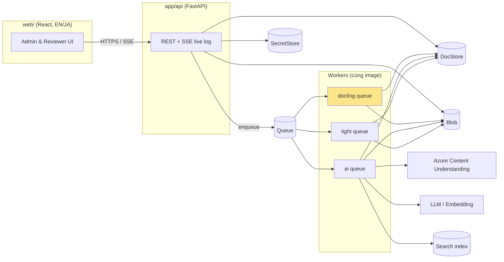
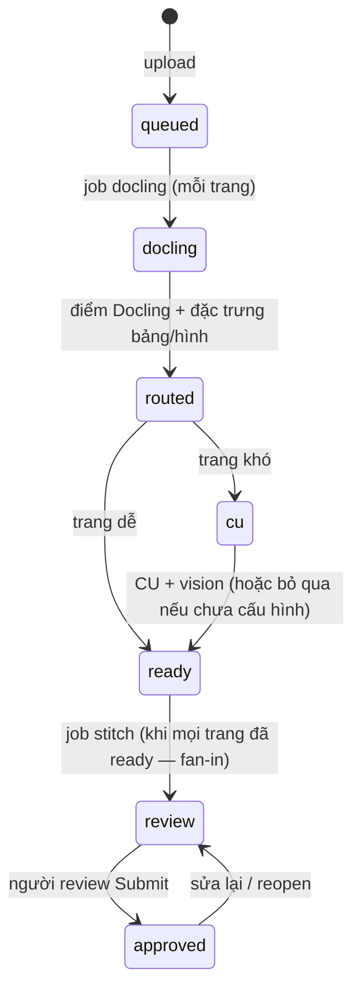

# Khu A — Hệ thống nạp tài liệu: kiến trúc đã triển khai

Bản này mô tả phần code trong repo. Sơ đồ tổng thể gốc (khu A + B): `HokenAIBot_Architecture_v3.png`.

## 1. Thành phần

| Port | Local (dev / VM) | Azure | AWS |
|---|---|---|---|
| DocStore | Postgres (JSONB) | Cosmos DB | DynamoDB |
| Queue | Postgres (`SKIP LOCKED`) | Storage Queue | SQS |
| Blob | thư mục / volume | Blob Storage | S3 |
| SecretStore | AES-GCM trong DB | Key Vault | Secrets Manager |
| Search | pgvector + pg_bigm (RRF) | AI Search (hybrid + semantic) | OpenSearch (kuromoji + k-NN, RRF) |
| LLM / Embedding | OpenAI-compatible | Azure OpenAI | Bedrock |
| Layout (CU) | Azure | Azure | Azure |

## 2. Pipeline và trạng thái

Sau khi **mọi trang approved** → `chunk` (cắt thô theo mã mục → LLM ↔ kiểm tra luật ≤ 20 vòng → confidence) →
**review chunk** (mọi chunk phải approved) → `index` (embedding + upsert).

Tiêu chí **trang dễ** (theo `conv_res.confidence.pages[n]` của Docling, grade: <0.5 poor, <0.8 fair, <0.9 good, ≥0.9 excellent):
`low_score ≥ 0.8` · `parse_score ≥ 0.8` · không có `ocr_score` · không bảng gộp ô · không bảng chạm mép trên/dưới (tràn trang) ·
không hình > 5% trang (sau khi bỏ logo/con dấu/chữ ký). Tất cả chỉnh được trong Admin → Pipeline.

## 3. Job

- Khoá `docId:step:page` → tạo có điều kiện (`DocStore.create`) nên không chạy trùng.
- Worker: nhận message → `running` → handler → `succeeded` + xếp step tiếp theo; lỗi → retry 15s·2ⁿ → `failed`.
- Live log: mỗi step ghi `JobEvent{code, params}` (không có nội dung tài liệu); API stream qua SSE theo con trỏ id
  (id có thứ tự thời gian) nên chạy được trên cả Postgres, Cosmos, DynamoDB.
- Mỗi job lưu `config_version` của tuỳ chọn pipeline để chạy lại cho kết quả giống.

## 4. Cấu hình 4 lớp

1. Hạ tầng lõi — env / IaC (`.env.example`). Secret gốc ở Key Vault / Secrets Manager, nền tảng đưa vào env.
2. Dịch vụ AI & SSO — Admin UI (form sinh từ `AdapterSpec`), prod không có Local, CU chỉ Azure.
3. Secret của lớp 2 — SecretStore; DB chỉ giữ `secrets_set`. Ưu tiên Managed Identity / IAM role.
4. Tuỳ chọn pipeline — DB có phiên bản + lịch sử.

## 5. Phân quyền

| Vai trò | Quyền |
|---|---|
| Admin | Mọi thứ + cài đặt dịch vụ, secret, SSO, người dùng, audit |
| Reviewer | Upload, review OCR/chunk, chạy lại job, tìm thử |
| Viewer | Chỉ xem |

Đăng nhập: tài khoản nội bộ (scrypt) + OIDC Google / Microsoft Entra (PKCE, kiểm tra nonce, domain cho phép).
Phiên: cookie JWT HttpOnly SameSite=Lax; request ghi bắt buộc header `X-Requested-With` (chống CSRF).

## 6. Triển khai

| Mô hình | Cách chạy |
|---|---|
| Dev / một VM | `docker compose up -d --build` — postgres (pgvector + pg_bigm), api, worker-light, worker-ai ×2, worker-docling, web (nginx) |
| Azure | Container Apps: `web`, `api`. Container Apps Jobs (event-driven, KEDA `azure-queue` scaler) chạy `python -m app.main job --queues <q>` cho từng hàng đợi. Cosmos DB, Blob, Storage Queue, AI Search, Key Vault, Managed Identity |
| AWS | ECS Fargate: `web`, `api`; worker là ECS service scale theo độ dài SQS (hoặc RunTask chạy `job`). DynamoDB, S3, SQS, OpenSearch, Secrets Manager, Bedrock, IAM task role. CU vẫn gọi Azure |

Image: `docker/app.Dockerfile` (target `base` cho api/worker, target `docling` có model Docling tải sẵn lúc build),
`web/Dockerfile` (nginx, tắt buffer cho SSE), `docker/postgres/Dockerfile`.
