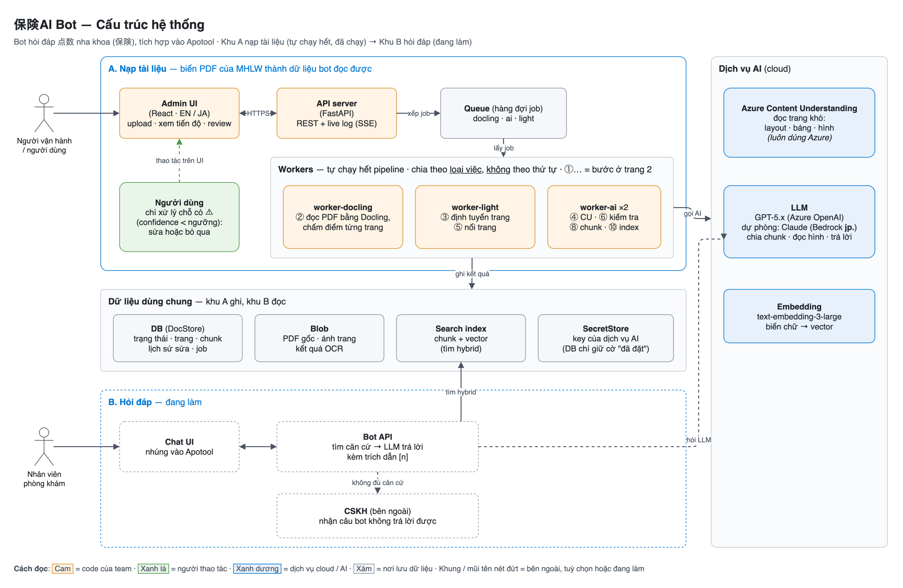
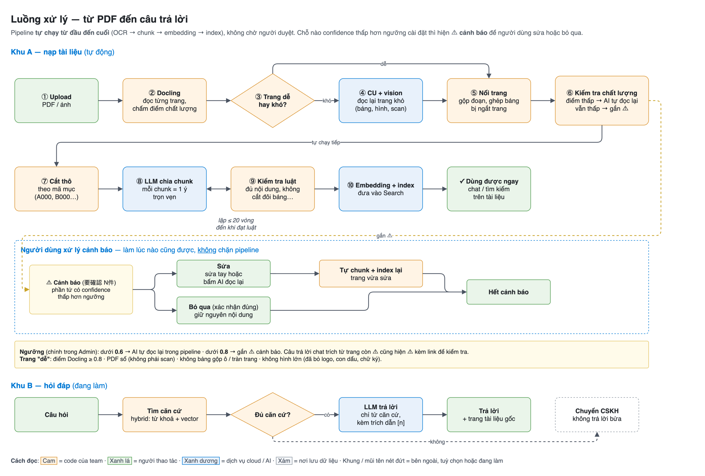

# 保険AI Bot — Cấu trúc hệ thống

> Sơ đồ gốc (sửa được): [01-cau-truc-he-thong.drawio](01-cau-truc-he-thong.drawio) — mở bằng draw.io / diagrams.net.
> Trang 1: Tổng quan · Trang 2: Luồng xử lý.

## 1. Hệ thống này làm gì?

Bot trả lời câu hỏi về **点数 nha khoa (保険)** cho nhân viên phòng khám, sẽ gắn vào **Apotool**.
Bot chỉ trả lời dựa trên tài liệu công khai của **MHLW**; câu nào không có căn cứ thì chuyển sang **CSKH**,
không trả lời bừa.

Hệ thống chia 2 khu:

| Khu | Việc | Trạng thái |
|---|---|---|
| **A. Nạp tài liệu** | Đọc PDF → cắt thành **chunk** → đưa vào **Search index**. **Tự chạy hết**, chỗ nào kém thì hiện ⚠ cảnh báo | Đã chạy |
| **B. Hỏi đáp** | Nhận câu hỏi → tìm căn cứ → **LLM** trả lời kèm trích dẫn | Đang làm (đã có bản thử trong UI) |

## 2. Sơ đồ tổng quan

**Cách đọc màu:** cam = code của team · xanh lá = người thao tác · xanh dương = dịch vụ cloud / AI ·
xám = nơi lưu dữ liệu · nét đứt = bên ngoài, tuỳ chọn hoặc đang làm.

## 3. Các thành phần

**Khu A — nạp tài liệu**

| Thành phần | Là gì | Làm gì |
|---|---|---|
| **Admin UI** | Web React, tiếng Nhật / tiếng Anh | Upload PDF, xem tiến độ (live log), xử lý ⚠ cảnh báo, chat thử |
| **API server** | FastAPI | Nhận yêu cầu từ UI, xếp việc vào **Queue**, đẩy live log qua **SSE** |
| **Queue** | Hàng đợi job | Chia việc thành 3 hàng: `docling` (nặng), `ai` (gọi AI), `light` (nhẹ) |
| **Workers** | Chương trình chạy nền | Lấy job từ Queue, tự chạy hết pipeline, ghi kết quả. Lỗi thì tự chạy lại |
| **Người dùng** | Người vận hành | **Không phải duyệt từng trang.** Chỉ xử lý chỗ có ⚠ (confidence thấp hơn ngưỡng): sửa hoặc bỏ qua |

> Worker chia theo **loại việc** (nặng / nhẹ / gọi AI), **không** theo thứ tự bước. Thứ tự bước xem mục 4.
> `worker-docling`: ② Docling · `worker-light`: ③ định tuyến, ⑤ nối trang ·
> `worker-ai`: ④ CU + vision, ⑥ kiểm tra chất lượng, ⑧ chunk, ⑩ embedding + index.

**Khu B — hỏi đáp**

| Thành phần | Làm gì |
|---|---|
| **Chat UI** | Khung chat nhúng trong Apotool |
| **Bot API** | Tìm căn cứ trong **Search index** → nhờ **LLM** viết câu trả lời kèm trích dẫn [n] |
| **CSKH** | Nhận những câu bot không đủ căn cứ để trả lời |

**Dữ liệu dùng chung** (khu A ghi, khu B đọc)

| Kho | Chứa gì |
|---|---|
| **DB (DocStore)** | Trạng thái tài liệu, từng trang, chunk, lịch sử sửa, job |
| **Blob** | File PDF gốc, ảnh trang, kết quả OCR (JSON / Markdown) |
| **Search index** | Chunk + **vector**, tìm kiểu **hybrid** (từ khoá + ý nghĩa) |
| **Secret** | Key của dịch vụ AI, client secret SSO: biến môi trường (prod lấy từ Key Vault / Secrets Manager). Không lưu trong DB |

**Dịch vụ AI (cloud)**

| Dịch vụ | Dùng để |
|---|---|
| **Azure Content Understanding (CU)** | Đọc lại trang khó: bảng phức tạp, hình, ảnh scan. **Luôn dùng Azure** |
| **LLM** — GPT-5.x (Azure OpenAI) | Chia chunk, đọc hình, viết câu trả lời. Dự phòng: Claude trên Bedrock profile `jp.` |
| **Embedding** — text-embedding-3-large | Biến chữ thành **vector** để tìm theo ý nghĩa |

## 4. Luồng xử lý

**Khu A — từ PDF đến dữ liệu bot dùng được** (tự chạy, không chờ người)

1. **Upload** PDF / ảnh.
2. **Docling** đọc từng trang và chấm điểm chất lượng.
3. **Định tuyến**: trang **dễ** đi thẳng; trang **khó** gửi sang **CU + vision** đọc lại.
4. **Nối trang**: chạy khi **mọi trang đã OCR xong** (Docling hoặc CU) — gộp đoạn văn, ghép bảng bị ngắt giữa 2 trang,
   bỏ header/footer. Chunking chỉ chạy trên kết quả đã nối.
5. **Kiểm tra chất lượng**: chấm **confidence** từng phần tử (đoạn, bảng, hình).
   Dưới **0.6** → AI tự đọc lại. Vẫn dưới **0.8** → gắn **⚠ cảnh báo**. Pipeline **vẫn chạy tiếp**.
6. **Cắt thô** theo mã mục → **LLM chia chunk** ↔ **kiểm tra luật** (lặp tối đa 20 vòng đến khi đạt).
7. **Embedding + index** → chat / tìm kiếm dùng được ngay.

**Người dùng xử lý cảnh báo** — làm lúc nào cũng được, không chặn pipeline:

| Cảnh báo ⚠ | Người dùng chọn | Kết quả |
|---|---|---|
| Phần tử có confidence thấp hơn ngưỡng | **Sửa** (sửa tay hoặc bấm AI đọc lại) | Trang đó tự **chunk + index lại**, hết cảnh báo |
| | **Bỏ qua** (xác nhận nội dung đúng) | Giữ nguyên, hết cảnh báo |

- Số cảnh báo còn mở hiện trên thẻ tài liệu (要確認 N件).
- Câu trả lời chat trích từ trang còn ⚠ cũng hiện ⚠ kèm link để kiểm tra.
- Ngưỡng (0.6 tự đọc lại, 0.8 cảnh báo) chỉnh trong Admin.

Trang **dễ** khi đủ tất cả: điểm Docling ≥ 0.8, là PDF số (không phải scan), không có bảng gộp ô / bảng tràn trang,
không có hình lớn (đã bỏ logo, con dấu, chữ ký). Ngưỡng chỉnh được trong Admin.

**Khu B — trả lời câu hỏi**

Câu hỏi → tìm căn cứ (**hybrid**) → đủ căn cứ? → **có**: LLM trả lời **chỉ** từ căn cứ, kèm trích dẫn trang gốc ·
**không**: chuyển **CSKH**.

## 5. Nguyên tắc chính

- **Tự động trước, người xử lý ngoại lệ**: pipeline tự chạy hết để dùng được ngay. Người chỉ xem chỗ có ⚠
  (confidence thấp hơn ngưỡng cài đặt) và chọn sửa hoặc bỏ qua.
- **Dữ liệu ở Nhật** (prod): lưu và xử lý tại Azure **Japan East**, LLM dùng deployment **Standard**
  (không Global / Data Zone).
- **Không lộ nội dung**: log chỉ ghi mã, id, số trang, lý do — không chép nội dung tài liệu hay câu hỏi.
- **Một code, nhiều nơi chạy**: mỗi kho / dịch vụ có **adapter** cho Local, Azure, AWS. Đổi nơi chạy chỉ cần đổi
  cấu hình, không sửa code.

| Thành phần | Local (dev) | Azure | AWS |
|---|---|---|---|
| DB | Postgres | Cosmos DB | DynamoDB |
| Blob | Thư mục | Blob Storage | S3 |
| Queue | Bảng Postgres | Storage Queue | SQS |
| Search | Postgres + pgvector + pg_bigm | AI Search | OpenSearch |
| Secret | `.env` | Key Vault → env | Secrets Manager → env |
| LLM / Embedding | OpenAI-compatible | Azure OpenAI | Bedrock |
| CU | Azure | Azure | Azure |

## 6. Phân quyền

| Vai trò | Được làm |
|---|---|
| **Admin** | Mọi thứ + tuỳ chọn pipeline, người dùng, audit; xem cấu hình dịch vụ AI / SSO |
| **Reviewer** | Upload, review OCR / chunk, chạy lại job, tìm thử |
| **Viewer** | Chỉ xem |

Đăng nhập bằng tài khoản nội bộ hoặc **SSO** Google / Microsoft Entra.

---
Chi tiết kỹ thuật hơn: [`docs/ARCHITECTURE.md`](../ARCHITECTURE.md) · Server: [02-server.md](02-server.md)
