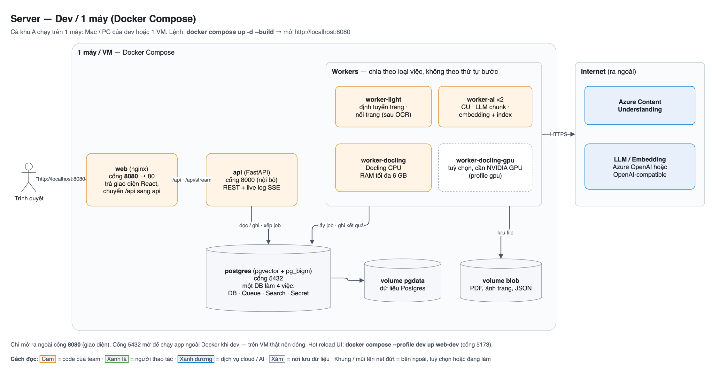
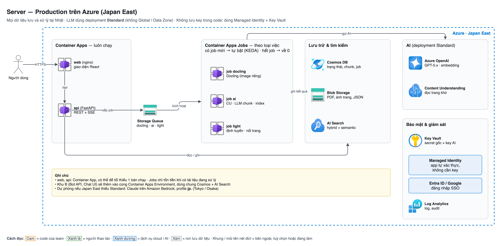
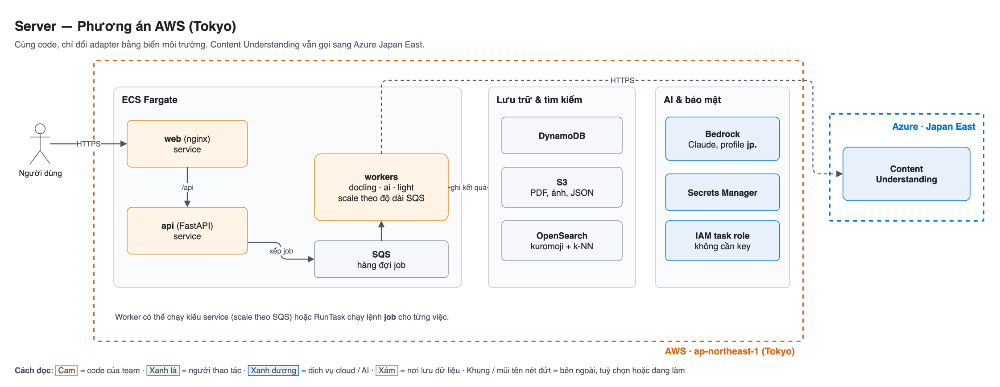

# 保険AI Bot — Server

> Sơ đồ gốc (sửa được): [02-server.drawio](02-server.drawio) — 3 trang: Dev / 1 VM · Prod Azure · Phương án AWS.

## 1. Tóm tắt

Cùng một bộ code chạy được ở 3 nơi. Chỉ đổi **biến môi trường** (file `.env`), không sửa code.

| Môi trường | Dùng khi | Chạy bằng |
|---|---|---|
| **Dev / 1 VM** | Máy dev, demo, PoC | **Docker Compose** trên 1 máy |
| **Prod — Azure Japan East** | Chạy thật (khuyến nghị) | **Container Apps** + **Container Apps Jobs** |
| **AWS Tokyo** | Phương án dự phòng | **ECS Fargate** |

Ở mọi môi trường, phần mềm gồm cùng 3 loại "máy chạy" (container):

- **web** — nginx, trả giao diện React và chuyển các yêu cầu `/api` sang **api**.
- **api** — FastAPI, nhận yêu cầu, xếp job, đẩy live log (**SSE**).
- **worker** — chạy nền, xử lý từng trang. Chia theo **loại việc** (không theo thứ tự bước):
  `docling` (nặng), `ai` (gọi AI), `light` (nhẹ). Pipeline tự chạy hết, không chờ người. Số bước ②…⑩ xem
  [luồng xử lý](01-cau-truc-he-thong.md#4-luồng-xử-lý).

## 2. Dev / 1 VM (Docker Compose)



| Container | Cổng | Tài nguyên | Ghi chú |
|---|---|---|---|
| `web` (nginx) | **8080** → 80 | nhỏ | Cổng duy nhất người dùng cần mở |
| `api` (FastAPI) | 8000 (nội bộ) | nhỏ | |
| `worker-docling` | — | **RAM tối đa 6 GB** | Bước ② Docling. Nặng nhất; model Docling tải sẵn trong image |
| `worker-light` | — | nhỏ | Bước ③ định tuyến, ⑤ nối trang (sau OCR, trước chunk) |
| `worker-ai` ×2 | — | nhỏ | Bước ④ CU, ⑥ kiểm tra chất lượng, ⑧ chunk, ⑩ embedding + index. Chủ yếu chờ mạng → tăng số bản nếu cần nhanh hơn |
| `worker-docling-gpu` | — | 1 GPU NVIDIA | Tuỳ chọn, bật bằng `--profile gpu` |
| `postgres` | 5432 | | Có **pgvector + pg_bigm**. Một DB làm 4 việc: DB · Queue · Search · Secret |

Dữ liệu nằm trong 2 **volume**: `pgdata` (Postgres) và `blob` (PDF, ảnh trang, JSON).

**Cấu hình máy đề xuất** (ước tính, chưa đo tải thật):

| | Tối thiểu | Thoải mái |
|---|---|---|
| CPU | 4 vCPU | 8 vCPU |
| RAM | 16 GB | 32 GB |
| Ổ đĩa | 50 GB SSD | 100 GB SSD |
| GPU | không cần | NVIDIA (Docling nhanh hơn nhiều) |

**Chạy:**

```bash
cp .env.example .env
```

```bash
docker compose up -d --build
```

Mở `http://localhost:8080` → màn Setup tạo admin đầu tiên. Trong `.env` phải đổi `SECRET_MASTER_KEY` và `JWT_SECRET`.

**Mạng:**
- **Vào**: chỉ cần mở cổng **8080** (hoặc 443 nếu đặt reverse proxy / HTTPS phía trước).
  Cổng 5432 chỉ mở khi dev chạy app ngoài Docker — trên VM thật nên đóng.
- **Ra** (worker gọi dịch vụ AI qua HTTPS): `*.cognitiveservices.azure.com`, `*.openai.azure.com`,
  `*.services.ai.azure.com` (và `*.search.windows.net`, `*.blob.core.windows.net` nếu dùng dịch vụ Azure tương ứng).

## 3. Production — Azure Japan East



| Phần | Dịch vụ Azure | Ghi chú |
|---|---|---|
| Giao diện + API | **Container Apps**: `web`, `api` | Luôn chạy (tối thiểu 1 bản) |
| Worker | **Container Apps Jobs**: `docling`, `ai`, `light` | **KEDA** thấy job mới trong queue thì bật, hết job thì về 0 → chỉ tốn tiền khi đang xử lý |
| Hàng đợi | **Storage Queue** | 3 hàng: docling · ai · light |
| DB | **Cosmos DB** | Trạng thái, trang, chunk, job |
| File | **Blob Storage** | PDF, ảnh trang, kết quả OCR |
| Tìm kiếm | **AI Search** | Hybrid + semantic. PoC: Free → Serverless; prod: Basic |
| AI | **Azure OpenAI** (GPT-5.x, embedding), **Content Understanding** | Deployment **Standard** — không Global / Data Zone |
| Secret | **Key Vault** | Secret gốc + key dịch vụ AI |
| Xác thực | **Managed Identity** | App tự xác thực với dịch vụ Azure, không cần lưu key |
| Đăng nhập | **Entra ID / Google** | SSO |
| Log | **Log Analytics** | Log, audit (chỉ mã + id, không nội dung) |

- Mọi dịch vụ đặt tại **Japan East** → dữ liệu lưu và xử lý tại Nhật.
- Khu B (Bot API, Chat UI) sẽ thêm vào cùng Container Apps Environment, dùng chung Cosmos DB + AI Search.
- Nếu Japan East thiếu deployment Standard: dự phòng Claude trên **Amazon Bedrock**, profile `jp.` (Tokyo / Osaka).

## 4. Phương án AWS (Tokyo)



| Phần | Dịch vụ AWS |
|---|---|
| Giao diện + API | **ECS Fargate** service: `web`, `api` |
| Worker | ECS service scale theo độ dài **SQS** (hoặc **RunTask** chạy lệnh `job`) |
| Hàng đợi / DB / File | **SQS** · **DynamoDB** · **S3** |
| Tìm kiếm | **OpenSearch** (kuromoji cho tiếng Nhật + k-NN) |
| AI | **Bedrock** — Claude, profile `jp.` |
| Secret / xác thực | **Secrets Manager** · **IAM task role** |
| Đọc trang khó | **Content Understanding** — vẫn gọi sang **Azure Japan East** |

## 5. Cấu hình nằm ở đâu?

| Lớp | Gồm | Ai đặt | Đặt ở đâu |
|---|---|---|---|
| 1. Hạ tầng lõi | DB, Blob, Queue, Secret backend, JWT | DevOps | Biến môi trường / IaC (`.env.example`) |
| 2. Dịch vụ AI & SSO | LLM, embedding, CU, Search, SSO | Admin | Màn Cài đặt trên UI (prod không có lựa chọn Local) |
| 3. Secret của lớp 2 | API key | Admin | SecretStore (Key Vault / Secrets Manager); DB chỉ giữ cờ "đã đặt" |
| 4. Tuỳ chọn pipeline | Ngưỡng trang dễ, ngưỡng cảnh báo / tự đọc lại, số vòng chunk… | Admin | DB, có phiên bản; mỗi job ghi phiên bản đã dùng |

Ví dụ đổi nơi chạy DB / file / queue (lớp 1):

| Biến | Local | Azure | AWS |
|---|---|---|---|
| `DB_TYPE` | `postgres` | `cosmos` | `dynamodb` |
| `BLOB_TYPE` | `local` | `azure` | `s3` |
| `QUEUE_TYPE` | `postgres` | `azure` | `sqs` |
| `SECRET_BACKEND` | `local` | `azure_keyvault` | `aws_secrets` |

## 6. Image

| Image | Build từ | Dùng cho |
|---|---|---|
| `hoken-app` | `docker/app.Dockerfile` (target `base`) | api, worker-light, worker-ai |
| `hoken-docling` | `docker/app.Dockerfile` (target `docling`) | worker-docling — có sẵn model, chạy không cần mạng tải model |
| `hoken-web` | `web/Dockerfile` | web (nginx; tắt buffer cho SSE) |
| `hoken-postgres` | `docker/postgres/Dockerfile` | Postgres + pgvector + pg_bigm (chỉ Local / VM) |

---
Cấu trúc hệ thống: [01-cau-truc-he-thong.md](01-cau-truc-he-thong.md) · Chi tiết kỹ thuật: [`docs/ARCHITECTURE.md`](../ARCHITECTURE.md)
